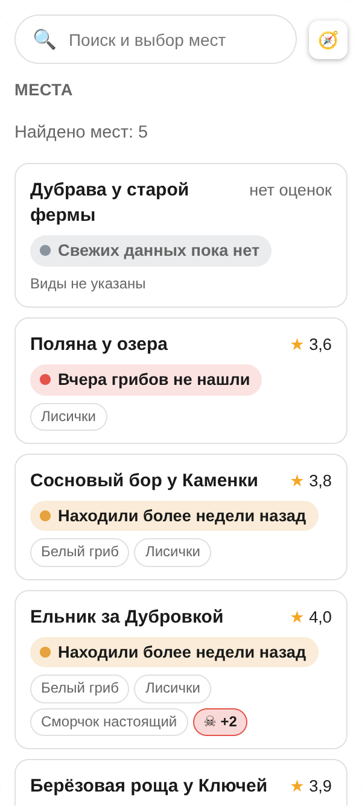
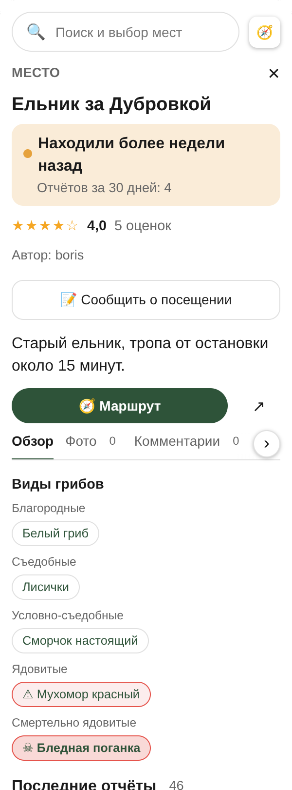
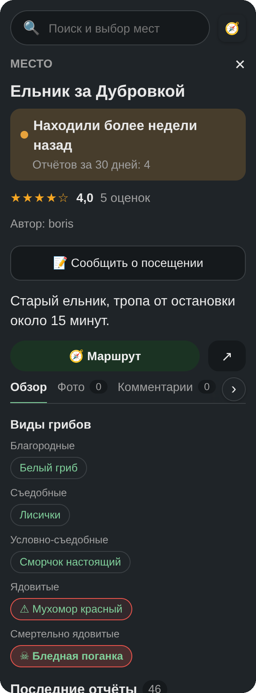
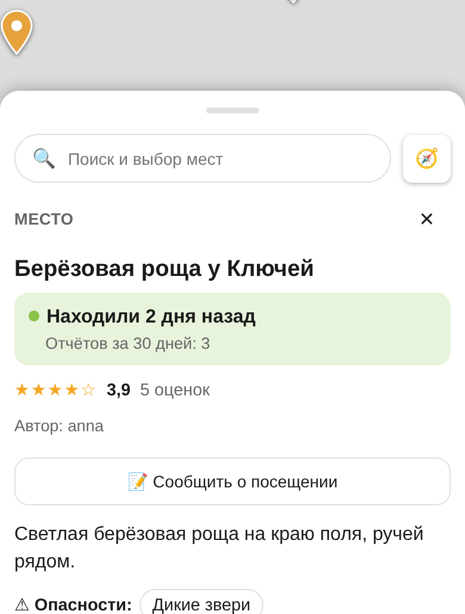
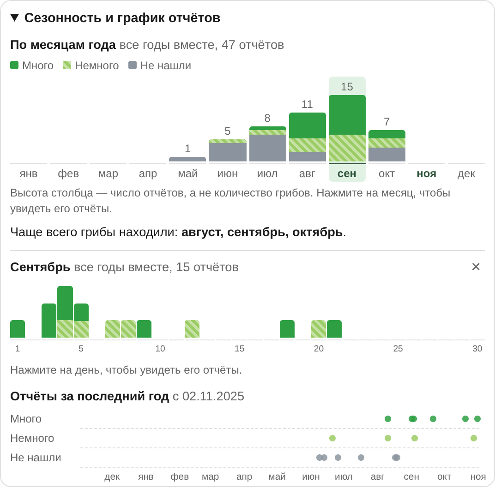

# 🍄 Грибные места

Веб-приложение с интерактивной картой для грибников: отмечайте места, делитесь отчётами о посещениях и смотрите, **когда именно** в каждом месте бывают грибы. Интерфейс построен по образцу Яндекс и Google Карт, работает на компьютере и на телефоне.

> Проект учебный и запускается локально. Это не определитель съедобности: [читайте раздел о безопасности](#безопасность).

<p align="center">
  
  
  
  
</p>

<p align="center">
  
</p>

## Возможности

**Карта и места**
- Интерактивная карта (Leaflet): метки цветом показывают статус места, близкие метки собираются в кластеры.
- Добавление и правка мест: название, описание, виды грибов, опасности (дикие звери, болото, клещи и др.), фото.
- Поиск по названию, фильтры по видам грибов и по тому, когда в последний раз находили грибы, область поиска, которую можно нарисовать на карте.
- Маршрут до места (OSRM) от вашего местоположения или от любой точки на карте, меню по правому клику (добавить место, маршрут сюда/отсюда, отчёт, область).

**Отчёты и сезонность**
- Отчёты о посещении: «много», «немного» или «не нашёл», дата, виды, заметка.
- **Статус места** считается автоматически по свежим отчётам, а не вводится вручную.
- **Графики сезонности**: по месяцам года (все годы вместе), по дням выбранного месяца и по времени за последний год. По клику на месяц и день открываются сами отчёты.

**Люди и доверие**
- Оценки мест (1–5 звёзд), комментарии с фото, лайки и дизлайки, профили пользователей.
- Оценить место можно только после своего отчёта о посещении, и не автору. Оценить пользователя можно только после посещения его места. Вес голоса зависит от репутации голосующего, но сглажен, чтобы оценки нельзя было накрутить подставными аккаунтами.
- Блокировка пользователей, жалобы.

**Справочник и определение по фото**
- Справочник из 56 видов грибов по категориям (благородные, съедобные, условно-съедобные, ядовитые, смертельно ядовитые, несъедобные): описание, местообитание, двойники, источники.
- Опасные виды в карточке места и в списке помечены значками: ⚠ ядовитый, ☠ смертельно ядовитый.
- Подсказка «определить гриб по фото» (необязательно, нужны `torch` и `timm`): загрузка файла или снимок камерой прямо в окне, до пяти вариантов с предупреждением об опасных видах.

**Интерфейс**
- Светлая и тёмная темы.
- На телефоне карточки открываются нижней шторкой: свёрнута, половина, во весь рост.
- Доступность: подписи кнопок для экранных читалок, видимый фокус, уважение к настройке «без анимаций».

## Как это работает

**Статус места** (`spots/status.py`). Решает самый свежий отчёт за последние 30 дней, более старые отчёты в статусе не участвуют:

| Самый свежий отчёт за 30 дней | Статус (цвет метки) |
|---|---|
| «много» или «немного», сегодня | Сегодня находили грибы (зелёный) |
| находка вчера или не позже недели назад | Вчера находили грибы / Находили N дней назад (светло-зелёный) |
| находка раньше, чем неделю назад | Находили более недели назад (жёлтый) |
| «не нашёл» | Не находили … / Грибов не нашли (красный) |
| отчётов за 30 дней нет | Свежих данных пока нет (серый) |

**Сезонность** (`spots/seasonality.py`). Чистая функция превращает отчёты в данные для графиков. Высота столбца — число *отчётов*, а не количество грибов, и вывод «чаще всего грибы находили в…» делается только когда отчётов достаточно (не меньше 5, а месяц называется сезонным при минимум двух находках).

**Оценки и доверие** (`accounts/utils.py`, `spots/models.py`). Средняя оценка места взвешена по доверию к голосующим (вес от 0,5 до 1,5, у новичка ровно 1) и сглажена: к настоящим оценкам добавляются две «нейтральные», поэтому одна оценка «5» даёт 4,0, а не 5,0. Рейтинг пользователя входит в вес тоже сглаженным по числу полученных оценок. Если нужно убрать накрутку, удалите оценки в админке: рейтинг пересчитается автоматически.

## Безопасность

- Приложение **не определяет съедобность**. Категория вида берётся только из базы, а «съедобные» виды намеренно не выделены цветом: пометка «безопасно» по одному названию создавала бы ложное чувство надёжности.
- Определение по фото даёт подсказку, а не ответ: проценты не показываются, всегда предупреждается, что по фото грибы есть нельзя, а опасные виды среди вариантов называются независимо от их места в списке.
- Тексты справочника — черновики. Для 19 видов из 56 указаны внешние источники, для остальных 37 текст помечен как черновик «без внешнего источника». Флаг `is_verified` («Проверено») ставит человек в админке.

## Стек

- Python 3.12+, Django 6.1, SQLite, Pillow.
- Фронтенд: шаблоны Django, ванильный JS, CSS в `static/css/` (без сборки, Node и фреймворков).
- Карта: Leaflet 1.9.4, Leaflet Routing Machine 3.2.12 и Leaflet.markercluster 1.5.3 (с CDN unpkg), тайлы CARTO на основе OpenStreetMap, маршруты через демо-сервер OSRM.
- Определение по фото (необязательно): PyTorch, timm и модель Danish Fungi.

## Быстрый старт

Нужны Python 3.12+ и доступ в интернет (карта подгружает тайлы и библиотеки).

```bash
git clone https://github.com/MakarShaburov/Mushroom_map.git
cd Mushroom_map

python -m venv .venv
# Windows (PowerShell):  .venv\Scripts\Activate.ps1
# Linux и macOS:         source .venv/bin/activate

pip install -r requirements.txt
```

Создайте файл `.env` по образцу `.env.example`:

```
SECRET_KEY=любая-длинная-случайная-строка
CARTO_API_KEY=
```

`SECRET_KEY` обязателен. `CARTO_API_KEY` подставляется в адрес тайлов CARTO: укажите, если ключ у вас есть.

```bash
python manage.py migrate
python manage.py load_mushroom_reference   # тексты справочника видов
python manage.py createsuperuser           # для админки /admin/
python manage.py runserver
```

Откройте <http://127.0.0.1:8000/>. На Windows для файлов с русским текстом запускайте команды как `python -X utf8 manage.py ...`.

`load_mushroom_reference` заполняет только пустые поля справочника и не трогает правки из админки (флаг `--force` перезапишет их). Сами виды и категории создаёт миграция.

## Определение гриба по фото (необязательно)

Сайт полностью работает и без этой функции: тогда кнопка 📷 не показывается.

```bash
pip install -r requirements-ml.txt
```

Модель [`BVRA/tf_efficientnet_b0.in1k_ft_df20_384`](https://huggingface.co/BVRA/tf_efficientnet_b0.in1k_ft_df20_384) скачивается из интернета при первом определении, поэтому первый запрос медленный. Названия классов лежат в `spots/data/fungi_classes.json`; пересобрать их можно командой `build_fungi_classes` из таблиц метаданных датасета Danish Fungi. Скрипт `tools/fungi_model_check.py` проверяет модель отдельно от сайта.

Важно:
- Модель обучена на датских видах, всегда называет один из своих классов и бывает уверенно неправа.
- Лицензия модели **CC BY-NC 4.0**: для коммерческого использования её нужно заменить. Атрибуцию в результате не убирайте.
- Загруженное фото не сохраняется.
- Съёмка камерой работает только на `localhost` и по HTTPS (ограничение браузеров).

## Посмотреть на телефоне

- **Быстрее всего:** режим телефона в браузере компьютера (`F12`, затем `Ctrl+Shift+M`).
- **С настоящего телефона по Wi-Fi:** добавьте IP компьютера в `ALLOWED_HOSTS` в `mushroom_map/settings.py` (временно, не коммитьте), запустите `python manage.py runserver 0.0.0.0:8000` и откройте `http://IP-компьютера:8000`. Камера и геолокация по обычному `http` с адреса в сети не работают.
- **Android по кабелю:** USB-отладка, `chrome://inspect`, проброс порта 8000, затем `http://localhost:8000` на телефоне. Тогда камера и геолокация работают.

## Проверки

```bash
python manage.py check
python manage.py makemigrations --check --dry-run   # лишних миграций быть не должно
python manage.py test
```

Тесты лежат в `spots/tests.py` и покрывают расчёт статуса и сезонности, правила оценок и доверия, разметку карточек, подключение стилей (включая проверку, что все CSS-переменные определены), определение по фото на заглушке модели и другое. Интерфейс на JS автотестами не покрыт: его проверяют вручную и в браузере.

## Структура проекта

```
mushroom_map/        настройки и корневые маршруты
accounts/            профили, рейтинг и доверие, блокировки, жалобы, вход и регистрация
spots/               места, виды, фото, комментарии, оценки, отчёты, справочник
  status.py          статус места по отчётам (чистая функция)
  seasonality.py     данные для графиков сезонности (чистые функции)
  identify.py        определение по фото
  data/              справочник видов и названия классов модели
  management/        load_mushroom_reference, build_fungi_classes
templates/           шаблоны; templates/spots/map.html — страница карты и её JS
static/css/          tokens.css (общие значения), base.css, pages.css, map.css, map-phone.css
tools/               проверка модели без Django
docs/screenshots/    снимки для этого README
```

Стили подключаются в таком порядке: `tokens.css` → `base.css` → `pages.css` → (на карте) `map.css` → `map-phone.css`. Цвета, радиусы, тени, слои и шкала размеров заданы переменными в `tokens.css`; цвета статусов оттуда читает и JS, рисующий метки.

## Ограничения

- Проект рассчитан на локальную разработку: `DEBUG = True`, `ALLOWED_HOSTS = []`. Для публичного запуска понадобятся настройки продакшена, HTTPS, `STATIC_ROOT` с `collectstatic` и отдельная защита от накрутки.
- Карта зависит от внешних сервисов (CARTO, CDN unpkg, демо-сервер OSRM с лимитами) и без интернета не работает.
- Нет уведомлений и подписок на места.

## Планы

- Подписка на места и уведомление, когда в отслеживаемом месте появился отчёт о грибах.
- Источники и проверка для оставшихся 37 видов справочника.
- Публичный запуск: HTTPS, продакшен-настройки, модерация.

## Данные и лицензии

- Карта: © участники [OpenStreetMap](https://www.openstreetmap.org/copyright), © [CARTO](https://carto.com/attributions). Подпись источника на карте должна оставаться видимой.
- Модель распознавания: Danish Fungi (BVRA), CC BY-NC 4.0.
- Лицензия самого проекта пока не выбрана: до её добавления действуют обычные правила авторского права.
